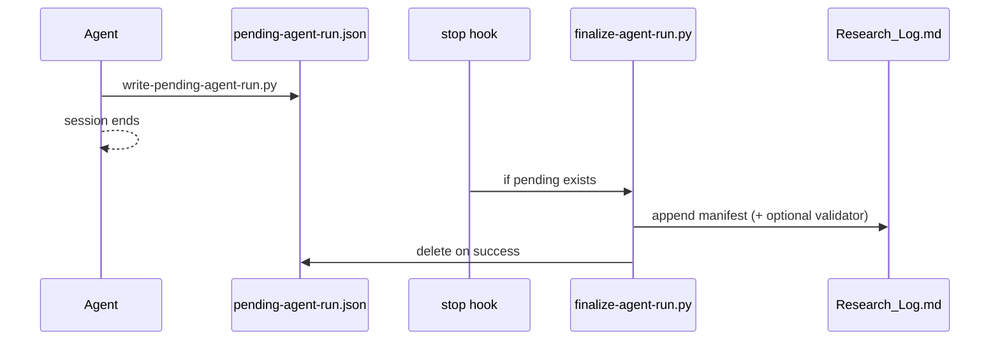

# Post-Run Hooks

Automated finalization for genealogy agent sessions: validator pass (optional), manifest append, pending file cleanup.

## Components

| Piece | Purpose |
|---|---|
| [scripts/write-pending-agent-run.py](../scripts/write-pending-agent-run.py) | Agent writes Run Summary fields to `.cursor/pending-agent-run.json` |
| [scripts/finalize-agent-run.py](../scripts/finalize-agent-run.py) | Runs validator (optional), appends manifest, clears pending |
| [.cursor/hooks.json](../.cursor/hooks.json) | Cursor `stop` and `afterShellExecution` hooks |
| [reference/agent-run-manifest.md](agent-run-manifest.md) | Manifest schema |

## Cursor flow



If the agent already ran `append-agent-run.py`, the `afterShellExecution` hook removes the pending file to prevent duplicate append on stop.

## Agent protocol

After the mandatory Run Summary:

```bash
python3 scripts/write-pending-agent-run.py \
  --vault-path "$VAULT_PATH" \
  --route-key <route_key> \
  --hat-at-close <hat> \
  --recommended-next-route <next_route> \
  --metric-name <name> --metric-before <n> --metric-after <n> --metric-delta <n> \
  --confidence-notes "..." \
  --run-validator
```

Cursor finalizes on session stop. Other platforms run finalize explicitly:

```bash
python3 scripts/finalize-agent-run.py
```

One-shot (no pending file):

```bash
python3 scripts/finalize-agent-run.py \
  --vault-path "$VAULT_PATH" \
  --route-key prompt:01-tree-expansion \
  --hat-at-close research_executor \
  --recommended-next-route workflow:validator-pass
```

## Pending manifest fields

All [agent_run manifest](agent-run-manifest.md) fields plus:

| Field | Type | Description |
|---|---|---|
| `vault_path` | string | Required in pending file; falls back to `VAULT_PATH` in `.env.local` |
| `run_validator` | boolean | When true, `finalize-agent-run.py` runs `run-validator.py` before append |
| `standalone` | boolean | When true, write full manifest to `agent_runs/{run_id}.md` |

Example: [.cursor/pending-agent-run.example.json](../.cursor/pending-agent-run.example.json)

## Validator integration

Set `--run-validator` on write-pending (or `run_validator: true` in JSON) when the prior route changed canonical vault files. Finalize sets `validator_result` to `PASS` or `FAIL` and writes `validator_report.md` when not dry-run.

Skip validator for orchestrator-only or human-bridge runs.

## Idempotency

Finalize skips append when the computed `run_id` already exists in the vault. Pending file is still cleared.

## Troubleshooting

| Symptom | Fix |
|---|---|
| Hook never runs | Confirm `.cursor/hooks.json` is loaded (Cursor Hooks settings); restart Cursor |
| Pending never clears | Run `python3 scripts/finalize-agent-run.py` manually |
| Duplicate manifests | Ensure agent does not both append and write pending; rely on one path |
| Missing vault | Set `VAULT_PATH` in `.env.local` or pass `--vault-path` |

## Non-Cursor platforms

Codex, Claude Code, and Gemini do not load Cursor hooks. End every session with:

```bash
python3 scripts/finalize-agent-run.py
```

Or call `append-agent-run.py` directly if validator is not needed.
